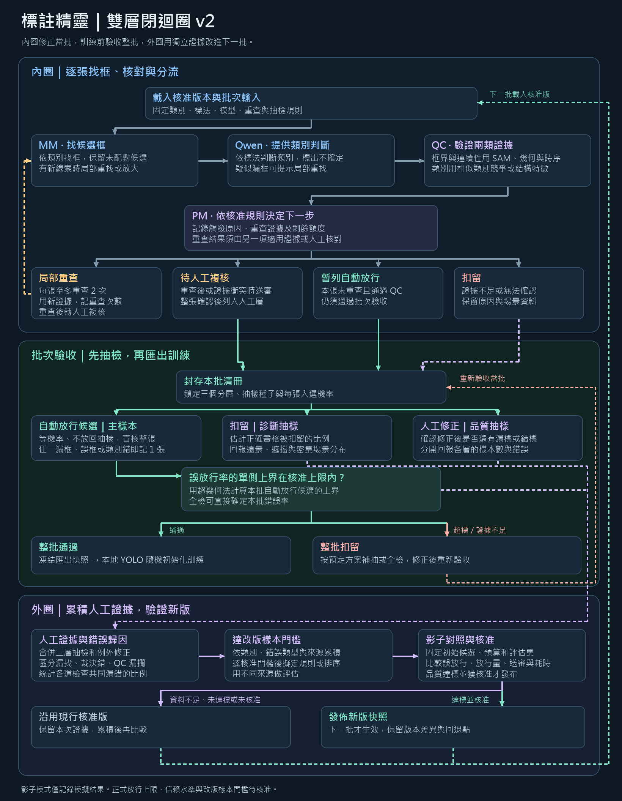

# 標註精靈雙層閉迴圈 v2

## 功能

- 新批次每張最多執行兩次 MM 局部重查。沒有新合格候選就停止，重查過的畫格在影子流程進人工複核或扣留。
- Qwen 提供類別和不確定訊號。QC 另外以 MM 比對相似類別、範圍及未配對候選。選配 SAM 每張最多核對兩個候選框，紀錄遮罩外接框和 IoU。
- 同一視窗提供影子待審與批次驗收。按自動候選、扣留及人工確認分層抽樣，整張盲標封存後才揭示原框。固定有限母體的錯誤率採精確超幾何單側界限。
- 人工修正與抽檢可作為跨批改版證據。驗收判定目前以影子模式記錄，正式放行及改版門檻待核准。

## 冒煙驗證

下表記錄發布前的本機驗證。新增測試、GUI 冒煙腳本與完整日誌保存在本機開發專案。

| 檢查 | 範圍 |
|---|---|
| 單元測試 | **110 項通過、2 項因工作樹內無權重而略過。** 檢查覆核、抽樣上下界、誤放行狀態、清冊驗證、獨立來源、舊專案格式與模型替身。 |
| Tkinter | **18 項冒煙檢查通過。** 以獨立合成專案同視窗檢視候選和 SAM 疊圖、定位重查例外、整張盲標、查看原框、提交及前往下一項，再切到訓練頁。 |
| Windows AppContainer | **2 張實圖通過流程驗證。** MM 共產生 20 個候選，Qwen 採用 2 框，選配 SAM 核對 2 框，影子模式送審 1 張。3 項網路探測均被拒，沙箱核實 CUDA 可用。推論耗時 24.396 秒，整次作業耗時 39.515 秒。 |

兩張實圖都未觸發局部重查，重查停損由測試替身驗證。實際命中率和誤放行率需使用獨立的整張人工參考估計。

本機模型與 AppContainer 執行環境的配置見 [README](../README.md)。驗收結果只適用於當批抽檢；評估新影片或類別應使用來源獨立的人工參考。
